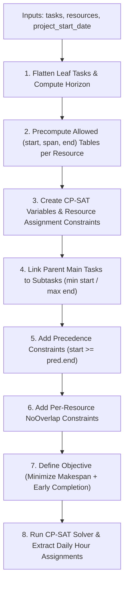

# How `solve_schedule` Works (`src/scheduler.py`)

This document explains step by step how [`solve_schedule`](file:///Users/ernstvorsteveld/git/python/marimo/py-cp-sat-simple-planning/src/scheduler.py#L62-L357) models and solves the task and resource scheduling problem using **Google OR-Tools CP-SAT** (`ortools.sat.python.cp_model`).

---

## High-Level Pipeline



---

## Step 1: Flatten Leaf Tasks & Compute the Planning Horizon

Location: [`src/scheduler.py` (lines 72–95)](file:///Users/ernstvorsteveld/git/python/marimo/py-cp-sat-simple-planning/src/scheduler.py#L72-L95)

1. **Identify Leaf Tasks**:
   - Every item in `tasks` is a [`Task`](file:///Users/ernstvorsteveld/git/python/marimo/py-cp-sat-simple-planning/src/models.py#L39-L61).
   - If a main task has `subtasks=[]` (e.g., `T1`–`T6`), the main task itself is a **leaf task** that directly requires work.
   - If a main task has `subtasks=[...]` (e.g., `M1`–`M4`), its subtasks are the **leaf tasks**, while the main task acts as a summary envelope over its subtasks.
2. **Compute Upper-Bound `horizon` (in calendar days)**:
   - CP-SAT integer variables (`IntVar`) require finite lower and upper bounds `[0, horizon]`.
   - The solver computes the worst-case working days needed if every leaf task were executed sequentially by the resource with the smallest `hours_per_day`:
     $$\text{work\_days} = \left\lceil \frac{\text{hours\_needed}}{\text{hours\_per\_day}} \right\rceil$$
   - Because resources can work as few as 4 days per week (pausing over Fri–Sun or Mon/Sat/Sun), `raw_work_days` is multiplied by `2.5` plus a 14-day buffer:
     ```python
     horizon = max(int(raw_work_days * 2.5) + 14, 14)
     ```
3. **Index Resources by Skill**:
   - Builds `resources_by_skill: dict[str, list[Resource]]` so each task can quickly look up which resources possess its `required_skill` (`"skill1"`, `"skill2"`, or `"skill3"`).

---

## Step 2: Precompute Allowed `(start_day, calendar_span, end_day)` Tuples

Location: [`compute_allowed_spans` (lines 25–59)](file:///Users/ernstvorsteveld/git/python/marimo/py-cp-sat-simple-planning/src/scheduler.py#L25-L59) and [`get_span_table` (lines 99–108)](file:///Users/ernstvorsteveld/git/python/marimo/py-cp-sat-simple-planning/src/scheduler.py#L99-L108)

A key challenge in calendar-aware scheduling is that **a task's calendar duration depends on both which resource is assigned and which day of the week it starts**:
- Suppose a task needs **24 hours** of `"skill1"` and is assigned to **Alice** (`8 hours/day`, working **Mon–Thu**, i.e., weekdays `{0, 1, 2, 3}`).
- Alice needs $\lceil 24 / 8 \rceil = 3$ **working days**.
- If Alice starts on **Monday (day 0)**, she works Mon, Tue, Wed $\rightarrow$ `start_day = 0, calendar_span = 3, end_day = 3`.
- If Alice starts on **Wednesday (day 2)**, she works Wed, Thu, **pauses over Fri, Sat, Sun**, and finishes on Monday (day 7) $\rightarrow$ `start_day = 2, calendar_span = 5, end_day = 7`.
- Alice is **not allowed** to start a task on Friday, Saturday, or Sunday.

`compute_allowed_spans(...)` simulates the calendar from `project_start_date` for every possible start offset `s` in `0..horizon-1` and returns the exact list of valid `(start_day, calendar_span, end_day)` triples. Results are cached by `(resource.id, work_days_needed)`.

---

## Step 3: Create Variables & Resource Assignment for Leaf Tasks (`add_leaf_task`)

Location: [`add_leaf_task` (lines 120–169)](file:///Users/ernstvorsteveld/git/python/marimo/py-cp-sat-simple-planning/src/scheduler.py#L120-L169)

For every leaf task (either a simple main task or a subtask), `add_leaf_task` creates two main decision variables:
- `t_start = model.new_int_var(0, horizon, f"start_{leaf.id}")`
- `t_end = model.new_int_var(0, horizon, f"end_{leaf.id}")`

It then branches into one of two cases:

### Case A: Passive Waiting Task (`hours_needed == 0` or `required_skill is None`)
- Used for subtasks like `"Wait for External Review (2d)"` (`hours_needed=0, wait_days=2`).
- Creates a fixed-size interval of `wait_days` calendar days:
  ```python
  model.new_interval_var(t_start, w_days, t_end, f"wait_iv_{leaf.id}")
  ```
- **No resource is assigned**, and the interval is **not** added to `resource_intervals`. This allows all resources to work on other tasks in parallel during the wait.

### Case B: Active Resource Task (`hours_needed > 0` and `required_skill` set)
1. **Find Eligible Resources**: Looks up all resources that have `leaf.required_skill`.
2. **One-Hot Resource Selection (`add_exactly_one`)**:
   - Creates one boolean variable `assign_{leaf.id}_{res.id}` per eligible resource.
   - Enforces that **exactly one** eligible resource is chosen:
     ```python
     model.add_exactly_one(list(assign_vars.values()))
     ```
3. **Table Constraint per Candidate Resource (`add_allowed_assignments`)**:
   - For each eligible resource `res`, computes `w_days = hours_to_work_days(leaf.hours_needed, res.hours_per_day)` and fetches `allowed_tuples = get_span_table(res, w_days)`.
   - Creates candidate variables `r_start`, `r_span`, `r_end` and restricts them to valid working-day combinations using CP-SAT's table constraint:
     ```python
     model.add_allowed_assignments([r_start, r_span, r_end], allowed_tuples)
     ```
4. **Channeling to Task Variables (`only_enforce_if`)**:
   - Links the task's actual `t_start`, `t_span`, `t_end` to the selected resource's `r_start`, `r_span`, `r_end`:
     ```python
     model.add(t_start == r_start).only_enforce_if(is_assigned)
     model.add(t_span == r_span).only_enforce_if(is_assigned)
     model.add(t_end == r_end).only_enforce_if(is_assigned)
     ```
5. **Optional Interval per Resource (`new_optional_interval_var`)**:
   - Creates an `IntervalVar` that is active **if and only if** `is_assigned` is true, and registers it in `resource_intervals[res.id]`:
     ```python
     opt_interval = model.new_optional_interval_var(
         r_start, r_span, r_end, is_assigned, f"opt_iv_{leaf.id}_{res.id}"
     )
     resource_intervals[res.id].append(opt_interval)
     ```

---

## Step 4: Link Main Tasks with Subtasks (`add_min_equality` / `add_max_equality`)

Location: [`src/scheduler.py` (lines 174–189)](file:///Users/ernstvorsteveld/git/python/marimo/py-cp-sat-simple-planning/src/scheduler.py#L174-L189)

When a main task has nested `subtasks` (e.g., `M1` containing `M1_S1`, `M1_S2`, `M1_S3`), the main task itself does not consume a resource directly—its span is the **envelope** of its subtasks:
- Its start day equals the **earliest** start day among its subtasks:
  ```python
  model.add_min_equality(t_start, [starts[sub.id] for sub in task.subtasks])
  ```
- Its end day equals the **latest** end day among its subtasks:
  ```python
  model.add_max_equality(t_end, [ends[sub.id] for sub in task.subtasks])
  ```
- Its calendar span `t_span` is automatically enforced to equal `t_end - t_start` by `model.new_interval_var(t_start, t_span, t_end, ...)`.

---

## Step 5: Precedence Constraints (`predecessors`)

Location: [`src/scheduler.py` (lines 190–196)](file:///Users/ernstvorsteveld/git/python/marimo/py-cp-sat-simple-planning/src/scheduler.py#L190-L196)

Both top-level tasks and subtasks can list `predecessors` (by task/subtask ID):
```python
model.add(starts[task.id] >= ends[pred_id])
```
- Because main tasks with subtasks have `starts[task.id]` and `ends[task.id]` tied to the min/max of their subtasks, any task that depends on `M1` (`predecessors=["M1"]`) will automatically wait until **all** subtasks of `M1` have finished.
- Similarly, if `M2` depends on `M1`, none of `M2`'s subtasks can start before `M1.start >= M1_prev.end` because `M2.start == min(M2_subtasks.start)`.

---

## Step 6: Per-Resource `NoOverlap` Constraints

Location: [`src/scheduler.py` (lines 198–201)](file:///Users/ernstvorsteveld/git/python/marimo/py-cp-sat-simple-planning/src/scheduler.py#L198-L201)

For each resource, CP-SAT enforces that none of its active optional intervals can overlap in time:
```python
for intervals in resource_intervals.values():
    if intervals:
        model.add_no_overlap(intervals)
```
- If `is_assigned` is `False` for a given `(task, resource)` pair, CP-SAT ignores that optional interval in `add_no_overlap`.
- If `is_assigned` is `True`, the interval is active and cannot overlap with any other task assigned to the same resource.

---

## Step 7: Objective Function

Location: [`src/scheduler.py` (lines 203–210)](file:///Users/ernstvorsteveld/git/python/marimo/py-cp-sat-simple-planning/src/scheduler.py#L203-L210)

```python
makespan = model.new_int_var(0, horizon, "makespan")
model.add_max_equality(makespan, [ends[t.id] for t in tasks])
model.minimize(
    makespan * 1000
    + sum(ends[t.id] for t in tasks) * 10
    + sum(ends[leaf.id] for leaf in all_leaf_tasks)
)
```
Why three weighted terms?
1. **`makespan * 1000` (Primary objective)**: Minimizes the overall project completion day (`max(ends)`). Because its weight (`1000`) dominates the secondary terms, the solver will never sacrifice project completion time.
2. **`sum(ends[t.id] for t in tasks) * 10` (Secondary tie-breaker)**: Among schedules with the same overall makespan, finishes each main task as early as possible instead of letting non-critical tasks float to the end of the project.
3. **`sum(ends[leaf.id] for leaf in all_leaf_tasks)` (Tertiary tie-breaker)**: Inside each main task, schedules individual subtasks as early as possible.

---

## Step 8: Solving & Post-Processing Daily Resource Hours

Location: [`src/scheduler.py` (lines 212–357)](file:///Users/ernstvorsteveld/git/python/marimo/py-cp-sat-simple-planning/src/scheduler.py#L212-L357)

1. **Solve with Time Limit**:
   - Runs `cp_model.CpSolver()` with `solver.parameters.max_time_in_seconds = time_limit_seconds`.
   - Checks `status_code in (cp_model.OPTIMAL, cp_model.FEASIBLE)`. If infeasible or invalid, returns an empty `ScheduleResult` with the status name.
2. **Extract `ScheduledTask` Records**:
   - Reads `solver.value(starts[...])`, `solver.value(ends[...])`, and `solver.boolean_value(assign_vars[...])` to build `ScheduledTask` objects with calendar dates (`start_anchor + timedelta(days=...)`).
3. **Compute Daily Hour Breakdown (`record_daily_hours`)**:
   - Walks through each calendar day `day_offset` in `range(start_day, end_day)` for each scheduled leaf task.
   - If `cal_date.weekday()` is in the assigned resource's `working_days`, allocates `min(remaining_hours, resource.hours_per_day)` hours on that date and appends a [`DailyAssignment`](file:///Users/ernstvorsteveld/git/python/marimo/py-cp-sat-simple-planning/src/models.py#L84-L93) record:
     - For example, a `20h` task assigned to an `8h/day` resource over 3 working days allocates `8h` on day 1, `8h` on day 2, and `4h` on day 3.
   - Off-days in the span are automatically skipped (0 hours allocated).
