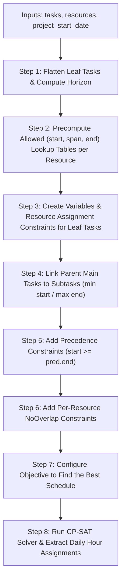
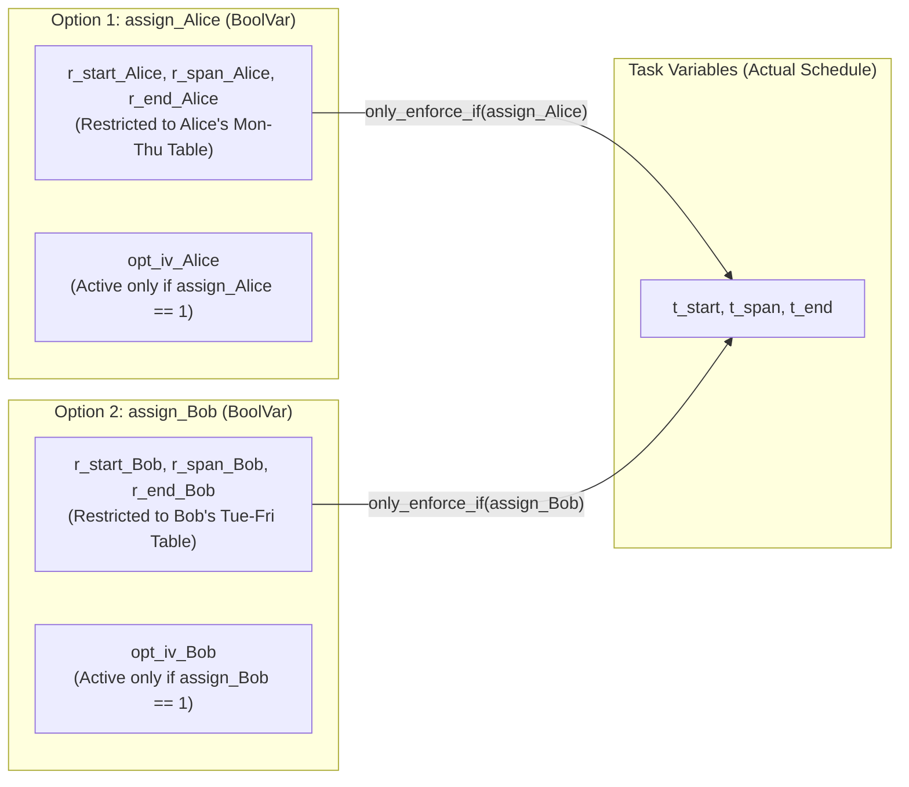

# How `solve_schedule` Works (`src/scheduler.py`)

This guide explains how [`solve_schedule`](file:///Users/ernstvorsteveld/git/python/marimo/py-cp-sat-simple-planning/src/scheduler.py#L62-L357) uses **Google OR-Tools CP-SAT** (`ortools.sat.python.cp_model`) to build an optimal project schedule. It is written so that even if you have never used a constraint solver before, you can understand **what CP-SAT is doing, why each constraint exists, and how the solver finds the best schedule**.

---

## Part 1: What is CP-SAT and How Does It Think?

In normal Python programming (**imperative programming**), you write a step-by-step recipe: *"Take task 1, put it on Monday, assign it to Alice, then check if Bob is free on Tuesday..."*
The problem with writing a manual loop for scheduling is that an early greedy choice (like giving Task 1 to Alice instead of Bob) might block a critical chain of tasks two weeks later.

**CP-SAT** (**C**onstraint **P**rogramming with **SAT**isfiability) works completely differently. Instead of writing an algorithm that *places* tasks one by one, you describe the rules of the puzzle using **three building blocks**, and the CP-SAT engine searches through all valid combinations to find the mathematically best schedule:

1. **Decision Variables ("The Unknowns")**:
   Variables whose values the solver is allowed to choose—for example, *"On which day does task `T1` start?"* (`IntVar`) or *"Is `T1` assigned to Alice?"* (`BoolVar`). Every variable is initially an unknown box with a range of allowed integer values (its **domain**, e.g. `0..horizon`).
2. **Constraints ("The Rules of the Game")**:
   Mathematical or logical rules that any valid schedule must obey—for example, *"Task B cannot start before Task A ends"*, *"Alice cannot work on two tasks at the same time"*, or *"Alice only works Monday through Thursday."*
3. **Objective Function ("What Makes One Schedule Better Than Another")**:
   A mathematical score that the solver tries to **minimize** (or maximize)—in our case, finishing the entire project in as few calendar days as possible, while also starting and finishing individual tasks as early as possible.

---

## Part 2: Quick Glossary of CP-SAT Building Blocks Used in `src/scheduler.py`

Before reading the code step by step, here are the exact CP-SAT methods we use and what they mean in plain English:

| CP-SAT Method | What It Creates / Enforces | Plain-English Meaning in Our Scheduler |
| :--- | :--- | :--- |
| `model.new_int_var(0, horizon, name)` | An integer decision variable (`IntVar`) in `[0, horizon]` | Represents a day number (e.g., `start_T1`, `end_T1`, `span_T1`). Day `0` is `project_start_date`. |
| `model.new_bool_var(name)` | A boolean decision variable (`BoolVar`, `0` or `1`) | A true/false switch, such as `assign_T1_Alice` (`1` = Alice does `T1`, `0` = she does not). |
| `model.add_exactly_one([b1, b2, ...])` | Sum of booleans `== 1` | Out of all resources who have the required skill for a task, **exactly one** resource must be picked. |
| `model.add_allowed_assignments([v1, v2, v3], tuples)` | Table constraint | Forces `(start, span, end)` to match one of the pre-calculated rows in a lookup table (used to respect each resource's working days and off-days). |
| `model.add(expr).only_enforce_if(bool_var)` | Conditional constraint ("if-then") | *"If `assign_T1_Alice` is True (`1`), then `T1`'s start, span, and end must equal Alice's candidate start, span, and end."* |
| `model.new_interval_var(start, size, end, name)` | Always-active time interval (`IntervalVar`) | Represents a time block from `start` to `end` where `start + size == end` is automatically enforced. |
| `model.new_optional_interval_var(start, size, end, is_present, name)` | Conditional time interval (`IntervalVar`) | A time block on a specific resource's calendar that **only exists** if `is_present` (`assign_task_resource`) is True (`1`). |
| `model.add_no_overlap(intervals)` | Disjunctive resource constraint | Ensures that none of the active intervals on a resource's calendar overlap in time (a person can only work on one task at a time). |
| `model.add_min_equality(target, vars)` | `target == min(vars)` | Sets a parent Main Task's start day to the **earliest** start day of its subtasks. |
| `model.add_max_equality(target, vars)` | `target == max(vars)` | Sets a parent Main Task's end day to the **latest** end day of its subtasks (and sets `makespan` to the latest end day of all tasks). |
| `model.minimize(expr)` | Objective function | Tells CP-SAT to search for the valid schedule with the lowest possible score `expr`. |

---

## Part 3: High-Level Pipeline of `solve_schedule`



---

## Part 4: Step-by-Step Walkthrough of `src/scheduler.py`

### Step 1: Flatten Leaf Tasks & Compute the Planning Horizon

Location: [`src/scheduler.py` (lines 72–95)](file:///Users/ernstvorsteveld/git/python/marimo/py-cp-sat-simple-planning/src/scheduler.py#L72-L95)

#### 1. What is a "Leaf Task"?
Every item in our model is a [`Task`](file:///Users/ernstvorsteveld/git/python/marimo/py-cp-sat-simple-planning/src/models.py#L39-L61), which can either:
- Have **no subtasks** (`subtasks=[]`, like `T1`–`T6`): the main task itself is a **leaf task** that requires a skilled resource.
- Contain **nested subtasks** (`subtasks=[...]`, like `M1`–`M4`): the subtasks inside it are the **leaf tasks** that do the actual work (or waiting), while the parent main task is simply a summary bar spanning from its first subtask to its last subtask.

#### 2. Why do we need a `horizon`?
CP-SAT requires every integer variable (`IntVar`) to have a finite minimum and maximum bound: `0` to `horizon` (measured in calendar days from `project_start_date`).
- If `horizon` is **too small**, the solver won't have enough calendar days to fit all tasks and will return `INFEASIBLE`.
- If `horizon` is **huge** (e.g. `1,000,000`), lookup tables become needlessly large and slow down the solver.

So we calculate a safe upper bound:
1. Convert every leaf task's hours into working days assuming the slowest resource (`min_hpd`):
   $$\text{work\_days} = \left\lceil \frac{\text{hours\_needed}}{\text{hours\_per\_day}} \right\rceil$$
2. Sum all working days and wait days (`raw_work_days`), then multiply by `2.5` + `14` days buffer to account for 3–4 day working weeks and weekends:
   ```python
   horizon = max(int(raw_work_days * 2.5) + 14, 14)
   ```

---

### Step 2: Precompute Allowed `(start_day, calendar_span, end_day)` Lookup Tables

Location: [`compute_allowed_spans` (lines 25–59)](file:///Users/ernstvorsteveld/git/python/marimo/py-cp-sat-simple-planning/src/scheduler.py#L25-L59) and [`get_span_table` (lines 99–108)](file:///Users/ernstvorsteveld/git/python/marimo/py-cp-sat-simple-planning/src/scheduler.py#L99-L108)

#### Why can't we just set `end_day = start_day + work_days`?
Because resources have **off-days** (weekends and part-time schedules), a task's **calendar duration (`span`)** changes depending on **who** does it and **which day of the week** it starts!

#### Concrete Example
Suppose `project_start_date` is **Monday, Oct 19, 2026 (Day 0)**, and task `T2` requires **24 hours** of `"skill1"`.
Suppose we consider assigning `T2` to **Alice**, who works **8 hours/day** on **Monday–Thursday** (weekdays `{0, 1, 2, 3}`, off on Fri/Sat/Sun):
- Alice needs $\lceil 24 / 8 \rceil = 3$ **working days**.
- What happens for different possible start days?

| Candidate Start Day `s` | Weekday | Days Alice Works | Off-Days Paused Over | End Day (`cur`) | Calendar Span (`end - s`) | Valid? |
| :--- | :--- | :--- | :--- | :--- | :--- | :--- |
| **Day 0** | Mon | Mon (0), Tue (1), Wed (2) | None | **Day 3** | **3 days** | Yes: `(0, 3, 3)` |
| **Day 1** | Tue | Tue (1), Wed (2), Thu (3) | None | **Day 4** | **3 days** | Yes: `(1, 3, 4)` |
| **Day 2** | Wed | Wed (2), Thu (3), Mon (7) | Fri (4), Sat (5), Sun (6) | **Day 8** | **6 days** | Yes: `(2, 6, 8)` |
| **Day 3** | Thu | Thu (3), Mon (7), Tue (8) | Fri (4), Sat (5), Sun (6) | **Day 9** | **6 days** | Yes: `(3, 6, 9)` |
| **Day 4, 5, 6** | Fri, Sat, Sun | — | — | — | — | **No** (Alice is off!) |

[`compute_allowed_spans`](file:///Users/ernstvorsteveld/git/python/marimo/py-cp-sat-simple-planning/src/scheduler.py#L25-L59) runs a simple Python `while` loop ahead of time to build this list of valid `(start_day, calendar_span, end_day)` triples for any `(resource, work_days_needed)` pair. We then hand this table directly to CP-SAT using `model.add_allowed_assignments(...)` in Step 3.

---

### Step 3: Create Variables & Resource Assignment for Leaf Tasks (`add_leaf_task`)

Location: [`add_leaf_task` (lines 120–169)](file:///Users/ernstvorsteveld/git/python/marimo/py-cp-sat-simple-planning/src/scheduler.py#L120-L169)

For every leaf task, we create its start and end decision variables:
```python
t_start = model.new_int_var(0, horizon, f"start_{leaf.id}")
t_end = model.new_int_var(0, horizon, f"end_{leaf.id}")
```
Then we check whether the leaf task is a **passive waiting task** or an **active resource task**:

#### Case A: Passive Waiting Task (`hours_needed == 0` or `required_skill is None`)
Some subtasks represent external waiting times, such as `M1_S2: "Wait for External Review (2d)"` (`hours_needed=0, wait_days=2`).
- It takes `w_days = leaf.wait_days` calendar days regardless of weekends:
  ```python
  model.new_interval_var(t_start, w_days, t_end, f"wait_iv_{leaf.id}")
  ```
- Because no human resource is needed, we **do not** assign any resource or add this interval to any resource's `NoOverlap` list. All resources remain 100% free to work on other tasks in parallel during those 2 wait days!

#### Case B: Active Resource Task (`hours_needed > 0` and `required_skill` set)
When a task requires a skill (e.g., `leaf.required_skill == "skill1"`), several resources might have that skill (e.g., **Alice** and **Bob** both have `"skill1"`). The solver must simultaneously decide **who** does the task and **when** they do it:



Here are the 5 lines of logic that wire this up:

1. **Find Eligible Resources**:
   Look up all resources in `resources_by_skill[leaf.required_skill]`.
2. **Pick Exactly One Resource (`add_exactly_one`)**:
   Create a `BoolVar` (`0` or `1`) for each eligible resource and force the solver to set **exactly one** of them to `1`:
   ```python
   assign_vars = {
       res.id: model.new_bool_var(f"assign_{leaf.id}_{res.id}")
       for res in eligible
   }
   model.add_exactly_one(list(assign_vars.values()))
   ```
3. **Restrict Each Candidate Resource to Its Working-Day Table (`add_allowed_assignments`)**:
   For each eligible resource `res`, calculate how many working days *that specific resource* needs (`w_days = math.ceil(leaf.hours_needed / res.hours_per_day)`), fetch its valid `(start, span, end)` table from Step 2, and constrain its candidate variables `r_start`, `r_span`, `r_end`:
   ```python
   model.add_allowed_assignments([r_start, r_span, r_end], allowed_tuples)
   ```
4. **Copy the Chosen Resource's Timing to the Task (`only_enforce_if`)**:
   If the solver picks resource `res` (`is_assigned == 1`), the task's actual `t_start`, `t_span`, and `t_end` must equal `r_start`, `r_span`, and `r_end`:
   ```python
   model.add(t_start == r_start).only_enforce_if(is_assigned)
   model.add(t_span == r_span).only_enforce_if(is_assigned)
   model.add(t_end == r_end).only_enforce_if(is_assigned)
   ```
5. **Create an Optional Interval on that Resource's Calendar (`new_optional_interval_var`)**:
   We create an `OptionalIntervalVar` controlled by `is_assigned` and add it to `resource_intervals[res.id]`:
   ```python
   opt_interval = model.new_optional_interval_var(
       r_start, r_span, r_end, is_assigned, f"opt_iv_{leaf.id}_{res.id}"
   )
   resource_intervals[res.id].append(opt_interval)
   ```
   - If the solver sets `is_assigned = 1` for Alice, `opt_iv_Alice` becomes a real, active block on Alice's calendar, while Bob's `opt_iv_Bob` (`is_assigned = 0`) disappears completely!

---

### Step 4: Link Parent Main Tasks to Their Subtasks (`add_min_equality` / `add_max_equality`)

Location: [`src/scheduler.py` (lines 174–189)](file:///Users/ernstvorsteveld/git/python/marimo/py-cp-sat-simple-planning/src/scheduler.py#L174-L189)

When a main task has subtasks (e.g., `M1` has subtasks `M1_S1`, `M1_S2`, `M1_S3`), when does `M1` start and when does `M1` finish?
- `M1` starts on the **earliest** day any of its subtasks starts:
  ```python
  model.add_min_equality(t_start, [starts[sub.id] for sub in task.subtasks])
  ```
- `M1` ends on the **latest** day any of its subtasks finishes:
  ```python
  model.add_max_equality(t_end, [ends[sub.id] for sub in task.subtasks])
  ```
- And `model.new_interval_var(t_start, t_span, t_end, f"interval_{task.id}")` automatically enforces `t_span == t_end - t_start`.

---

### Step 5: Enforce Task & Subtask Dependencies (`predecessors`)

Location: [`src/scheduler.py` (lines 190–196)](file:///Users/ernstvorsteveld/git/python/marimo/py-cp-sat-simple-planning/src/scheduler.py#L190-L196)

If Task B lists Task A in `predecessors`, Task B cannot start until Task A has finished:
```python
model.add(starts[task.id] >= ends[pred_id])
```
This works seamlessly for both top-level tasks and subtasks:
- If `M1_S2` has `predecessors=["M1_S1"]`, then `start_M1_S2 >= end_M1_S1`.
- If `M1_S1` and `M1_S2` have **no** predecessors between them, the solver is free to schedule them **in parallel** on the same days (as long as they don't use the same single resource at the same time).
- Because a parent main task `M1` has `start_M1 == min(subtasks)` and `end_M1 == max(subtasks)`, if `M2` has `predecessors=["M1"]`, then `start_M2 >= end_M1` automatically forces **all** subtasks of `M2` to wait until **all** subtasks of `M1` are complete!

---

### Step 6: Prevent Double-Booking Resources (`add_no_overlap`)

Location: [`src/scheduler.py` (lines 198–201)](file:///Users/ernstvorsteveld/git/python/marimo/py-cp-sat-simple-planning/src/scheduler.py#L198-L201)

In Step 3, every time a resource was a candidate for a task, we appended an `OptionalIntervalVar` to `resource_intervals[res.id]`. Now we tell CP-SAT:
```python
for intervals in resource_intervals.values():
    if intervals:
        model.add_no_overlap(intervals)
```
What does `add_no_overlap` do?
- For each resource (Alice, Bob, Charlie, Diana), CP-SAT looks at all optional intervals where `is_assigned == 1` and guarantees that **no two active intervals on the same resource ever overlap**.
- This means one person can never work on two tasks at the same time.

---

### Step 7: Configure the Objective Function to Find the "Best" Schedule

Location: [`src/scheduler.py` (lines 203–210)](file:///Users/ernstvorsteveld/git/python/marimo/py-cp-sat-simple-planning/src/scheduler.py#L203-L210)

Many different schedules might satisfy all the constraints above. How do we tell CP-SAT what makes one schedule **the best**?

First, we define a variable called `makespan` equal to the completion day of the last task in the project:
```python
makespan = model.new_int_var(0, horizon, "makespan")
model.add_max_equality(makespan, [ends[t.id] for t in tasks])
```

Next, we tell CP-SAT to **minimize** a weighted formula with **three priorities**:
```python
model.minimize(
    makespan * 1000
    + sum(ends[t.id] for t in tasks) * 10
    + sum(ends[leaf.id] for leaf in all_leaf_tasks)
)
```

#### Why don't we just write `model.minimize(makespan)`?
Suppose your project takes **22 days** overall because of a long critical chain (`M1 -> M2 -> M3 -> M4`), and you also have a small independent task `T6` that only takes **2 days**.
- If you only minimize `makespan`, the solver sees no difference between finishing `T6` on **Day 2** vs. lazily delaying `T6` until **Day 22**—both give `makespan = 22`!
- By adding `+ sum(ends[t.id] for t in tasks) * 10 + sum(ends[leaf.id] for leaf in all_leaf_tasks)`, we create a **hierarchical tie-breaker**:
  1. **Priority 1 (`makespan * 1000`)**: Because `1000` is much larger than the sum of task count weights, the solver's #1 priority is always achieving the **shortest possible total project duration (`makespan`)**. Saving even 1 day on the total project makespan saves `1000` points.
  2. **Priority 2 (`sum(ends[t.id]) * 10`)**: Among all schedules that achieve the shortest project makespan, the solver picks the one that finishes every **Main Task** as early as possible (no lazy floating delays).
  3. **Priority 3 (`sum(ends[leaf.id]) * 1`)**: Inside each Main Task, the solver finishes every **Subtask** as early as possible.

---

### Step 8: Run the Solver & Calculate Daily Resource Hours

Location: [`src/scheduler.py` (lines 212–357)](file:///Users/ernstvorsteveld/git/python/marimo/py-cp-sat-simple-planning/src/scheduler.py#L212-L357)

#### 1. Configuring and Running `CpSolver`
```python
solver = cp_model.CpSolver()
solver.parameters.max_time_in_seconds = time_limit_seconds
status_code = solver.solve(model)
```
- `max_time_in_seconds` (default `5.0` seconds) sets a safety cap so the UI never freezes if a massive problem is loaded. For our 10 main tasks and 4 resources, CP-SAT proves optimality in a few milliseconds.
- **Checking Solver Status**:
  - `OPTIMAL`: CP-SAT found a valid schedule **and mathematically proved** that no better schedule exists.
  - `FEASIBLE`: CP-SAT found a valid schedule before the time limit ran out, though an even better one might exist.
  - `INFEASIBLE` / `MODEL_INVALID`: No valid schedule exists (for example, if a dependency cycle was created). Our code always checks for `(OPTIMAL, FEASIBLE)` before reading variable values.

#### 2. Reading Values Back from the Solver
Once solved, we query the chosen values using:
- `solver.value(starts[leaf.id])` and `solver.value(ends[leaf.id])` to get integer start/end day offsets, which are converted to calendar dates via `start_anchor + timedelta(days=...)`.
- `solver.boolean_value(assign_vars[res_id])` to see which resource's switch was set to `True` (`1`).

#### 3. Post-Processing Daily Hours (`record_daily_hours`)
Finally, [`record_daily_hours`](file:///Users/ernstvorsteveld/git/python/marimo/py-cp-sat-simple-planning/src/scheduler.py#L279-L302) translates each task's scheduled interval `[start_day, end_day)` into day-by-day [`DailyAssignment`](file:///Users/ernstvorsteveld/git/python/marimo/py-cp-sat-simple-planning/src/models.py#L84-L93) rows for the daily tables:
- It walks day by day from `start_day` to `end_day - 1`.
- If that date's weekday (`cal_date.weekday()`) is in the assigned resource's `working_days`, it allocates `min(remaining_hours, res.hours_per_day)` hours to that day and subtracts from `remaining_hours`.
- **Example**: If Charlie (`8h/day`, Mon–Thu) is assigned a **20-hour** task starting Wednesday:
  - **Wednesday**: `min(20, 8) = 8 hours` (`12h` remaining)
  - **Thursday**: `min(12, 8) = 8 hours` (`4h` remaining)
  - **Friday, Saturday, Sunday**: skipped (`0 hours`—not in Charlie's `working_days`)
  - **Monday**: `min(4, 8) = 4 hours` (`0h` remaining — task complete!)
