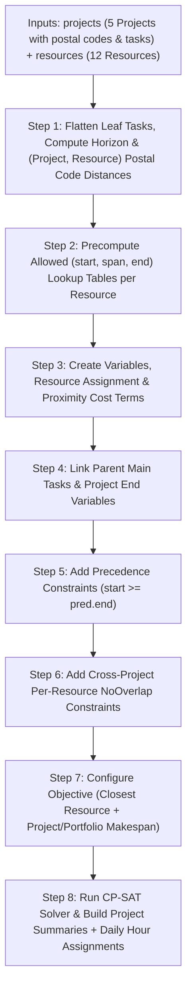

# How `solve_schedule` Works (`src/scheduler.py`)

This guide explains how [`solve_schedule`](file:///Users/ernstvorsteveld/git/python/marimo/py-cp-sat-simple-planning/src/scheduler.py#L63-L450) uses **Google OR-Tools CP-SAT** (`ortools.sat.python.cp_model`) to build an optimal multi-project schedule across a shared pool of skilled resources. It is written so that even if you have never used a constraint solver before, you can understand **what CP-SAT is doing, why each constraint exists, and how the solver finds the best schedule**.

---

## Part 1: What is CP-SAT and How Does It Think?

In normal Python programming (**imperative programming**), you write a step-by-step recipe: *"Take Project 1's first task, put it on Monday, assign it to Alice, then check if Bob is free on Tuesday..."*
The problem with writing a manual loop for multi-project scheduling is that an early greedy choice (like giving a task in Amsterdam to Alice from Utrecht instead of Bob from Amsterdam) might force someone to travel across the country or block a critical chain of tasks in another project.

**CP-SAT** (**C**onstraint **P**rogramming with **SAT**isfiability) works completely differently. Instead of writing an algorithm that *places* tasks one by one, you describe the rules of the puzzle using **three building blocks**, and the CP-SAT engine searches through all valid combinations to find the mathematically best schedule:

1. **Decision Variables ("The Unknowns")**:
   Variables whose values the solver is allowed to choose—for example, *"On which day does task `P1-T1` start?"* (`IntVar`) or *"Is `P1-T1` assigned to Diana?"* (`BoolVar`). Every variable is initially an unknown box with a range of allowed integer values (its **domain**, e.g. `min_start_day..horizon`).
2. **Constraints ("The Rules of the Game")**:
   Mathematical or logical rules that any valid schedule must obey—for example, *"Task B cannot start before Task A ends"*, *"Alice cannot work on two tasks at the same time (even across different projects)"*, or *"Alice only works Monday through Thursday."*
3. **Objective Function ("What Makes One Schedule Better Than Another")**:
   A mathematical score that the solver tries to **minimize**:
   - Assign tasks in each project to the eligible resource who lives **closest to that project's Dutch postal code**,
   - Finish the overall portfolio (`makespan`) and each individual project (`proj_end`) in as few calendar days as possible, and
   - Start and finish individual tasks and subtasks as early as possible.

---

## Part 2: Quick Glossary of CP-SAT Building Blocks Used in `src/scheduler.py`

Before reading the code step by step, here are the exact CP-SAT methods we use and what they mean in plain English:

| CP-SAT Method | What It Creates / Enforces | Plain-English Meaning in Our Scheduler |
| :--- | :--- | :--- |
| `model.new_int_var(lb, horizon, name)` | An integer decision variable (`IntVar`) in `[lb, horizon]` | Represents a day number (e.g., `start_P1-T1`, `end_P1-T1`). Day `0` is the earliest `project.start_date`. |
| `model.new_bool_var(name)` | A boolean decision variable (`BoolVar`, `0` or `1`) | A true/false switch, such as `assign_P1-T2_R1` (`1` = Alice does `P1-T2`, `0` = she does not). |
| `model.add_exactly_one([b1, b2, ...])` | Sum of booleans `== 1` | Out of all resources who have the required skill for a task, **exactly one** resource must be picked. |
| `model.add_allowed_assignments([v1, v2, v3], tuples)` | Table constraint | Forces `(start, span, end)` to match one of the pre-calculated rows in a lookup table (used to respect each resource's working days and off-days). |
| `model.add(expr).only_enforce_if(bool_var)` | Conditional constraint ("if-then") | *"If `assign_P1-T2_R1` is True (`1`), then `P1-T2`'s start, span, and end must equal Alice's candidate start, span, and end."* |
| `model.new_interval_var(start, size, end, name)` | Always-active time interval (`IntervalVar`) | Represents a time block from `start` to `end` where `start + size == end` is automatically enforced. |
| `model.new_optional_interval_var(start, size, end, is_present, name)` | Conditional time interval (`IntervalVar`) | A time block on a specific resource's calendar that **only exists** if `is_present` (`assign_task_resource`) is True (`1`). |
| `model.add_no_overlap(intervals)` | Disjunctive resource constraint | Ensures that none of the active intervals on a resource's calendar overlap in time—even across different projects! |
| `model.add_min_equality(target, vars)` | `target == min(vars)` | Sets a parent Main Task's start day to the **earliest** start day of its subtasks. |
| `model.add_max_equality(target, vars)` | `target == max(vars)` | Sets a parent Main Task's end day (or a Project's end day) to the **latest** end day of its children. |
| `model.minimize(expr)` | Objective function | Tells CP-SAT to search for the valid schedule with the lowest possible score `expr`. |

---

## Part 3: High-Level Pipeline of `solve_schedule`



---

## Part 4: Step-by-Step Walkthrough of `src/scheduler.py`

### Step 1: Flatten Leaf Tasks, Compute the Planning Horizon & Postal Code Distances

Location: [`src/scheduler.py` (lines 79–124)](file:///Users/ernstvorsteveld/git/python/marimo/py-cp-sat-simple-planning/src/scheduler.py#L79-L124)

#### 1. Multiple Projects & Leaf Tasks
We pass a list of 5 [`Project`](file:///Users/ernstvorsteveld/git/python/marimo/py-cp-sat-simple-planning/src/models.py#L53-L61) objects (`PRJ-001` in Utrecht, `PRJ-002` in Amsterdam, `PRJ-003` in Eindhoven, `PRJ-004` in Groningen, and `PRJ-005` in Rotterdam).
- `start_anchor = min(p.start_date for p in projects)` becomes **Day 0** of our shared calendar.
- Each project `proj` has a start offset `proj_offset = (proj.start_date - start_anchor).days`, meaning no task in `proj` can start before day `proj_offset`.
- Within each project, tasks without subtasks (`subtasks=[]`) and subtasks inside a Main Task (`subtasks=[...]`) are the **leaf tasks** that perform actual work or passive waiting.

#### 2. Computing the Upper-Bound `horizon`
CP-SAT requires every integer variable (`IntVar`) to have a finite minimum and maximum bound (`[proj_offset, horizon]`). We sum the worst-case working days across all leaf tasks in all projects and add a generous buffer for off-days:
```python
horizon = max(int(raw_work_days * 1.5) + max_proj_offset + 21, 30)
```

#### 3. Precomputing `(Project, Resource)` Postal Code Distances
Every project has an execution address (`proj.postal_code`) and every resource (`R1`–`R12`) has a home address (`res.postal_code`).
Using [`src/postal_codes.py`](file:///Users/ernstvorsteveld/git/python/marimo/py-cp-sat-simple-planning/src/postal_codes.py), we precompute for every `(proj.id, res.id)` pair:
- `distance_km_by_proj_res[(proj.id, res.id)]`: distance in kilometers (e.g., for `PRJ-004` in Groningen `9713 AV`, **Femke** in Groningen `9712 GK` is `0.5 km` away, whereas **Julia** in Maastricht `6211 CL` is `268.3 km` away).
- `distance_cost_by_proj_res[(proj.id, res.id)]`: integer distance in **hectometers** (`0.1 km` units, `round(distance_km * 10)`), used as an integer coefficient in the CP-SAT objective.

---

### Step 2: Precompute Allowed `(start_day, calendar_span, end_day)` Lookup Tables

Location: [`compute_allowed_spans` (lines 27–60)](file:///Users/ernstvorsteveld/git/python/marimo/py-cp-sat-simple-planning/src/scheduler.py#L27-L60) and [`get_span_table` (lines 129–141)](file:///Users/ernstvorsteveld/git/python/marimo/py-cp-sat-simple-planning/src/scheduler.py#L129-L141)

#### Why can't we just set `end_day = start_day + work_days`?
Because resources have **off-days** (weekends and part-time schedules), a task's **calendar duration (`span`)** changes depending on **who** does it and **which day of the week** it starts!

#### Concrete Example
Suppose `start_anchor` is **Monday, Oct 19, 2026 (Day 0)**, and task `P1-T2` requires **24 hours** of `"skill1"`.
Suppose we consider assigning `P1-T2` to **Alice**, who works **8 hours/day** on **Monday–Thursday** (weekdays `{0, 1, 2, 3}`, off on Fri/Sat/Sun):
- Alice needs $\lceil 24 / 8 \rceil = 3$ **working days**.
- What happens for different possible start days?

| Candidate Start Day `s` | Weekday | Days Alice Works | Off-Days Paused Over | End Day (`cur`) | Calendar Span (`end - s`) | Valid? |
| :--- | :--- | :--- | :--- | :--- | :--- | :--- |
| **Day 0** | Mon | Mon (0), Tue (1), Wed (2) | None | **Day 3** | **3 days** | Yes: `(0, 3, 3)` |
| **Day 1** | Tue | Tue (1), Wed (2), Thu (3) | None | **Day 4** | **3 days** | Yes: `(1, 3, 4)` |
| **Day 2** | Wed | Wed (2), Thu (3), Mon (7) | Fri (4), Sat (5), Sun (6) | **Day 8** | **6 days** | Yes: `(2, 6, 8)` |
| **Day 3** | Thu | Thu (3), Mon (7), Tue (8) | Fri (4), Sat (5), Sun (6) | **Day 9** | **6 days** | Yes: `(3, 6, 9)` |
| **Day 4, 5, 6** | Fri, Sat, Sun | — | — | — | — | **No** (Alice is off!) |

[`compute_allowed_spans`](file:///Users/ernstvorsteveld/git/python/marimo/py-cp-sat-simple-planning/src/scheduler.py#L27-L60) simulates the calendar for every possible start day `s >= min_start_day` and builds the exact list of valid `(start_day, calendar_span, end_day)` triples. We pass this table to CP-SAT using `model.add_allowed_assignments(...)` in Step 3.

---

### Step 3: Create Variables, Resource Assignment & Proximity Cost Terms (`add_leaf_task`)

Location: [`add_leaf_task` (lines 155–208)](file:///Users/ernstvorsteveld/git/python/marimo/py-cp-sat-simple-planning/src/scheduler.py#L155-L208)

For every leaf task in project `proj` (with earliest start offset `min_start_day`), we create its start and end decision variables:
```python
t_start = model.new_int_var(min_start_day, horizon, f"start_{leaf.id}")
t_end = model.new_int_var(min_start_day, horizon, f"end_{leaf.id}")
```
Then we check whether the leaf task is a **passive waiting task** or an **active resource task**:

#### Case A: Passive Waiting Task (`hours_needed == 0` or `required_skill is None`)
Some subtasks represent external waiting times, such as `P1-M1.3: "Certificate Authority Wait"` (`hours_needed=0, wait_days=3`).
- It takes `w_days = leaf.wait_days` calendar days regardless of weekends:
  ```python
  model.new_interval_var(t_start, w_days, t_end, f"wait_iv_{leaf.id}")
  ```
- Because no human resource is needed, we **do not** assign any resource or add this interval to any resource's `NoOverlap` list. All resources remain 100% free to work on other tasks in parallel during those wait days!

#### Case B: Active Resource Task (`hours_needed > 0` and `required_skill` set)
When a task requires a skill (e.g., `leaf.required_skill == "skill1"`), multiple resources across the Netherlands have that skill (`Alice` in Utrecht, `Bob` in Amsterdam, `Erik` in Eindhoven, `Femke` in Groningen, `Hannah` in Arnhem, `Julia` in Maastricht, `Koen` in Enschede). The solver must simultaneously decide **who** does the task and **when** they do it:

1. **Find Eligible Resources**:
   Look up all resources in `resources_by_skill[leaf.required_skill]`.
2. **Pick Exactly One Resource (`add_exactly_one`)**:
   Create a `BoolVar` (`0` or `1`) for each eligible resource and force the solver to set **exactly one** of them to `1`:
   ```python
   assign_vars = {
       res.id: model.new_bool_var(f"assign_{leaf.id}_{res.id}")
       for res in eligible
   }
   model.add_exactly_one(list(assign_vars.values()))
   ```
3. **Restrict Each Candidate Resource to Its Working-Day Table (`add_allowed_assignments`)**:
   For each eligible resource `res`, calculate how many working days *that specific resource* needs (`w_days = math.ceil(leaf.hours_needed / res.hours_per_day)`), fetch its valid `(start, span, end)` table from Step 2, and constrain its candidate variables `r_start`, `r_span`, `r_end`:
   ```python
   model.add_allowed_assignments([r_start, r_span, r_end], allowed_tuples)
   ```
4. **Copy the Chosen Resource's Timing to the Task (`only_enforce_if`)**:
   If the solver picks resource `res` (`is_assigned == 1`), the task's actual `t_start`, `t_span`, and `t_end` must equal `r_start`, `r_span`, and `r_end`. And if `res` is **not** picked (`~is_assigned`), we pin `r_start` to its first allowed value so CP-SAT does not waste time branching on unused candidate variables:
   ```python
   model.add(t_start == r_start).only_enforce_if(is_assigned)
   model.add(t_span == r_span).only_enforce_if(is_assigned)
   model.add(t_end == r_end).only_enforce_if(is_assigned)
   if allowed_tuples:
       model.add(r_start == allowed_tuples[0][0]).only_enforce_if(~is_assigned)
   ```
5. **Create an Optional Interval on that Resource's Shared Calendar (`new_optional_interval_var`)**:
   We create an `OptionalIntervalVar` controlled by `is_assigned` and add it to `resource_intervals[res.id]`:
   ```python
   opt_interval = model.new_optional_interval_var(
       r_start, r_span, r_end, is_assigned, f"opt_iv_{leaf.id}_{res.id}"
   )
   resource_intervals[res.id].append(opt_interval)
   ```
6. **Add a Project-to-Resource Postal Code Distance Cost Term (`distance_cost_terms`)**:
   ```python
   dist_cost = distance_cost_by_proj_res[(proj.id, res.id)]
   distance_cost_terms.append(is_assigned * dist_cost)
   ```

---

### Step 4: Link Parent Main Tasks & Project End Variables (`add_min_equality` / `add_max_equality`)

Location: [`src/scheduler.py` (lines 210–239)](file:///Users/ernstvorsteveld/git/python/marimo/py-cp-sat-simple-planning/src/scheduler.py#L210-L239)

1. **Main Task Envelope**:
   When a main task has subtasks, its start day equals the **earliest** start day of its subtasks (`add_min_equality`) and its end day equals the **latest** end day of its subtasks (`add_max_equality`).
2. **Project End Day (`project_end_vars[proj.id]`)**:
   For each of the 5 projects, we create `p_end = model.new_int_var(proj_offset, horizon, f"proj_end_{proj.id}")` and link it to the latest task in that project:
   ```python
   model.add_max_equality(p_end, [ends[t.id] for t in proj.tasks])
   ```

---

### Step 5: Enforce Task & Subtask Dependencies (`predecessors`)

Location: [`src/scheduler.py` (lines 241–248)](file:///Users/ernstvorsteveld/git/python/marimo/py-cp-sat-simple-planning/src/scheduler.py#L241-L248)

If Task B lists Task A in `predecessors`, Task B cannot start until Task A has finished:
```python
model.add(starts[task.id] >= ends[pred_id])
```

---

### Step 6: Prevent Double-Booking Resources Across All 5 Projects (`add_no_overlap`)

Location: [`src/scheduler.py` (lines 250–253)](file:///Users/ernstvorsteveld/git/python/marimo/py-cp-sat-simple-planning/src/scheduler.py#L250-L253)

```python
for intervals in resource_intervals.values():
    if intervals:
        model.add_no_overlap(intervals)
```
Because `resource_intervals[res.id]` collects optional intervals from **all 5 projects**, `add_no_overlap` guarantees that no resource is ever double-booked on two tasks at the same time—whether those two tasks belong to the same project or to two different projects!

---

### Step 7: Configure the Objective Function to Find the "Best" Schedule

Location: [`src/scheduler.py` (lines 255–267)](file:///Users/ernstvorsteveld/git/python/marimo/py-cp-sat-simple-planning/src/scheduler.py#L255-L267)

```python
makespan = model.new_int_var(0, horizon, "makespan")
model.add_max_equality(makespan, list(project_end_vars.values()))
model.minimize(
    sum(distance_cost_terms) * 1_000
    + makespan * 5_000
    + sum(project_end_vars.values()) * 1_000
    + sum(ends[t.id] for t in all_main_tasks) * 10
    + sum(ends[leaf.id] for leaf in all_leaf_tasks)
)
```

#### How the Objective Balances Proximity and Speed:
1. **`sum(distance_cost_terms) * 1_000` (Closest Resource Selection)**:
   Each `0.1 km` of distance between a project and an assigned resource costs `1,000` points (`10,000` points per km).
   - As a result, `PRJ-001` (Utrecht) strongly prefers **Alice (Utrecht)**, `PRJ-002` (Amsterdam) prefers **Bob (Amsterdam)** and **Lotte (Haarlem)**, `PRJ-003` (Eindhoven) prefers **Erik (Eindhoven)** and **Ivo (Breda)**, `PRJ-004` (Groningen) prefers **Femke (Groningen)** and **Gijs (Zwolle)**, and `PRJ-005` (Rotterdam) prefers **Charlie (Rotterdam)** and **Diana (Den Haag)**!
2. **`makespan * 5_000` + `sum(project_end_vars.values()) * 1_000` (Fast Project & Portfolio Completion)**:
   Keeps each individual project's completion date and the overall portfolio completion date as short as possible. If a local resource is already busy for a long stretch, the solver can bring in the next-closest regional resource when doing so saves enough calendar days to justify the small extra travel distance.
3. **`sum(ends[t.id]) * 10` + `sum(ends[leaf.id])` (Early Task & Subtask Completion)**:
   Ensures no task or subtask is lazily delayed when its assigned resource is already free.

---

### Step 8: Run the Solver & Build Project Summaries + Daily Resource Hours

Location: [`src/scheduler.py` (lines 269–450)](file:///Users/ernstvorsteveld/git/python/marimo/py-cp-sat-simple-planning/src/scheduler.py#L269-L450)

1. **Solve with Time Limit**:
   Runs `cp_model.CpSolver()` with `max_time_in_seconds = time_limit_seconds` and verifies `status_code in (cp_model.OPTIMAL, cp_model.FEASIBLE)`.
2. **Build `ProjectSummary` Records**:
   Computes each project's start/end dates, makespan in days, task counts, total effort hours, total resource distance (km), and the list of resources assigned to that project (`build_projects_df` displays this table in the notebook).
3. **Build `ScheduledTask` & `DailyAssignment` Records**:
   Extracts each task's start/end dates, assigned resource, resource postal code, distance to the project (km), and day-by-day working hours (`record_daily_hours`).
